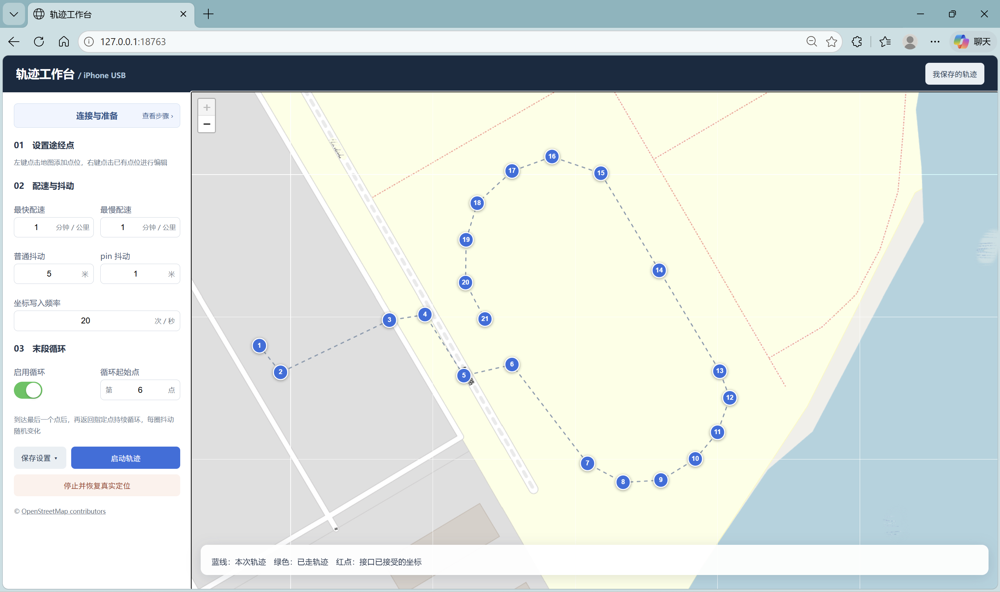
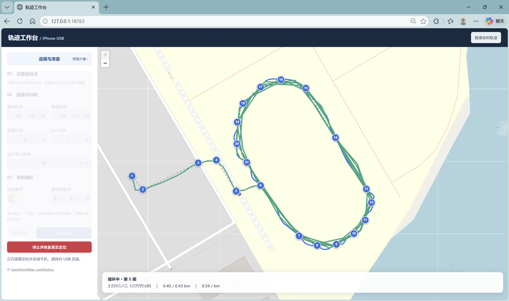

# 小工具_虚拟轨迹工作台

“小工具_虚拟轨迹工作台”是一款运行于Windows的iPhone USB虚拟定位工具。通过可视化地图添加、编辑、移动和插入途经点，生成平滑的模拟移动轨迹。支持自定义配速区间、随机抖动和坐标写入频率，可从指定点开始无限循环，每圈生成不同的抖动效果。工作台提供实时轨迹显示、路线命名保存与历史记录管理，支持一键启动及停止后恢复真实定位，适用于设备定位测试与路线模拟。使用前需完成依赖安装，并开启手机开发者模式。

## 界面演示

路线编辑：在地图上设置途经点，配置配速、抖动和循环范围。



循环运行：沿指定路段持续移动，每圈生成不同的随机抖动轨迹。



演示图为实际操作截图，其中的路线和参数仅用于展示；程序首次启动不预置这些点位。

## 开始使用

1. 将完整项目解压到当前用户有写权限的目录，支持中文和空格路径。
2. 按[安装准备说明](setup/README.md)准备Python 3.13、Apple USB通信组件和手机开发者模式。
3. 双击`setup/install.cmd`联网安装依赖，成功后双击根目录的`打开工作台.cmd`。
4. 连接一台已授权的iPhone，在手机上解锁并按提示信任电脑。打开网页本身不会改变定位，点击“启动轨迹”才开始模拟。

## 目录

```text
小工具_虚拟轨迹工作台/
├─ 打开工作台.cmd
├─ README.md                 项目总说明
├─ LICENSE                   MIT许可证
├─ .gitignore
├─ code/                     程序代码与网页
│  ├─ app.py                 本地服务与数据接口
│  ├─ worker.py              独立定位进程
│  ├─ trajectory.py          轨迹与循环算法
│  ├─ storage.py             数据保存
│  ├─ launch.ps1             内部启动脚本
│  └─ web/                   网页界面
└─ setup/                    安装准备
   ├─ install.cmd
   ├─ install.ps1
   ├─ requirements.txt
   └─ README.md
```

安装时创建根目录`.venv`，运行时创建`data`。两者均不随代码发布，并已被Git忽略。代码路径从文件所在位置推导，不需要修改用户名或安装目录。

## 功能与操作

- 左键点击地图新增点；右键点位可编辑、移动、删除或在该点之前插入新点。点位悬停高亮，菜单打开时点击空白处只关闭菜单。
- 最快、最慢配速使用分钟/公里，支持小数；相同即固定配速。普通抖动与pin抖动使用米。
- 写入频率支持1～20次/秒；实际频率受设备接口耗时影响。加载时显示连接动画，运行时参数区锁定，停止按钮高亮。
- 不循环时，到终点后持续写入精确终点。启用循环后，到末点再返回指定点无限循环，每圈重新生成抖动。循环连接为连续移动，不是瞬移。
- 设置可暂时保存，或命名保存到“我保存的轨迹”。支持载入，以及确认后删除历史记录。

## 数据与使用边界

`data/config.json`保存当前设置，`data/history.json`保存历史轨迹；其余文件为运行状态和日志。发布副本不携带个人配置文件、历史记录、日志或编译缓存，默认显示世界地图。项目顶层的演示截图包含示例路线及画面中显示的坐标，不会被程序载入。

关闭网页不会停止后台定位。请保持USB连接并避免电脑休眠；结束时点击“停止并恢复真实定位”，然后在手机地图确认。界面显示的是接口已接受的模拟坐标，不是手机定位回读。断线、休眠或重启后不保证持续模拟。

启动前请关闭其他虚拟定位工具，只连接一台目标手机。当前版本面向Windows，尚未适配macOS/Linux，也不保证所有iOS版本、机型和应用兼容。

安装前可解压到任意位置；安装后搬迁项目须先停止定位及后台服务，再在新位置重建`.venv`，保留`data`。Python虚拟环境不作为可直接搬迁的二进制包。启动器会检查端口，避免误打开其他目录的工作台。

## 网络与依赖

Python依赖固定为`pymobiledevice3==11.34.1`，其间接依赖由pip解析，目前并非完整哈希锁定。首次安装及开发者连接可能需要联网获取支持文件。

地图组件Leaflet 1.9.4从CDN加载，底图使用OpenStreetMap，因此离线重新打开网页不保证可用；已经运行的USB定位不依赖底图加载。地图只是参考，不作沿道路导航。

## 验证范围

本发布准备副本已在Windows上、包含中文和空格的独立测试目录中执行安装脚本，成功创建全新Python 3.13虚拟环境并安装依赖，pip依赖检查无冲突。安装过程使用了部分本机pip下载缓存，并非完全无缓存下载测试。

已通过Python、JavaScript与PowerShell语法检查、路径与静态隐私检查，以及本地网页服务、设置保存、历史记录保存与删除、跨来源写入拦截、无窗口解释器加载依赖检查。坐标写入、终点保持和停止流程使用模拟接口验证，未连接手机。

本次不属于全新Windows电脑上的驱动安装验证，未实际验证浏览器双击启动的完整流程，也未进行新环境的手机定位或最终视觉检查。因此不保证所有电脑、网络和iOS版本兼容。

## 许可证

本项目代码采用[MIT许可证](LICENSE)。第三方组件分别遵循其许可证和服务规则：

- [pymobiledevice3](https://github.com/doronz88/pymobiledevice3)
- [Leaflet](https://github.com/Leaflet/Leaflet)
- [OpenStreetMap版权说明](https://www.openstreetmap.org/copyright)与[瓦片使用规则](https://operations.osmfoundation.org/policies/tiles/)

页面保留OpenStreetMap署名，不批量下载离线瓦片。本目录可作为仓库根目录，尚未创建远程仓库或上传GitHub。
